# LiNEA40A — せおと配列と右手トラックボールのカスタム設定

[keyfreaksさんのLiNEA40用ZMK設定](https://github.com/keyfreaks/zmk-config-LiNEA40)をベースに、せおと配列での日本語入力、右手だけでのマウス・ブラウザー操作、Windowsでの利用に合わせて調整した個人用ファームウェア設定です。[LiNEA40本体のリポジトリ](https://github.com/keyfreaks/LiNEA40)

> [!NOTE]
> **2026年11月9日時点の記録です。** キーマップや設定は日常的に書き換えているため、READMEや画像に載っている内容が現在の `main` と異なる場合があります。最新の割り当てや設定値は [`main` の設定ファイル](https://github.com/gilldish/zmk-config-LiNEA40/tree/main/config) を参照してください。

## 主な機能

- [**キーマップ図**](#keymaps) — 通常入力、せおと裏面、マウス、数字、無線などのキー配置。
- [**せおと配列と日本語入力**](#seoto) — Space長押しで裏面を開き、「ん」「っ」、記号などを入力。
- [**オートマウスの解除**](#automouse) — ボール操作後はマウスレイヤーを最長10秒保持。左クリック操作からすぐに通常入力へ復帰。
- [**トラックボールとスクロール**](#pointing) — 一時的な低速化、ボールでのスクロール、ポインターの時計回り10°補正。
- [**Bluetoothとスリープ対策**](#bluetooth) — 接続間隔7.5 msを要求。パッチ適用版は、切断後のBLE再接続をキー押下まで待機。
- [**ショートカットとWindows連携**](#shortcuts) — キーの兼用、同時押し、Win＋矢印、右手でのYouTube操作。
- [**ビルドと設定ファイル**](#build) — GitHub Actionsで選べる2種類のビルドと、機能ごとの設定場所。

## キーマップ図

2026年11月9日版 v07。オレンジはコンボ、赤枠はレイヤー切替に関わるキー、薄い三角は下位レイヤーへ透過するキーです。予約枠のL3は全キーが透過します。画像をクリックすると個別に拡大できます。

[ページ間リンク付きのキーマップPDF](docs/keymap/LiNEA40_keymap_2026-11-09_v07.pdf)

[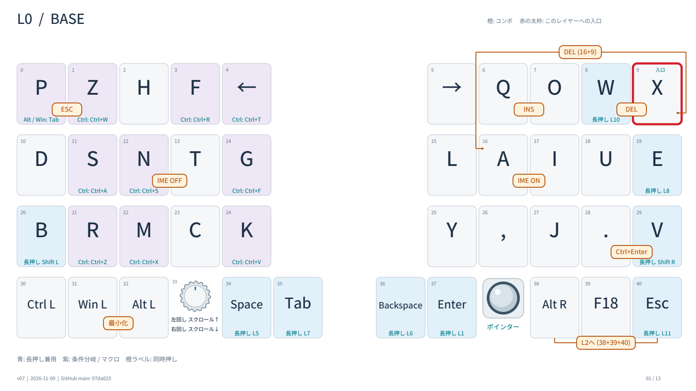](docs/keymap/l00-base.png)

[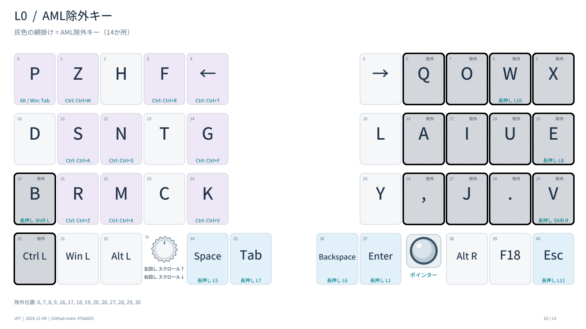](docs/keymap/aml-exclusions.png)

[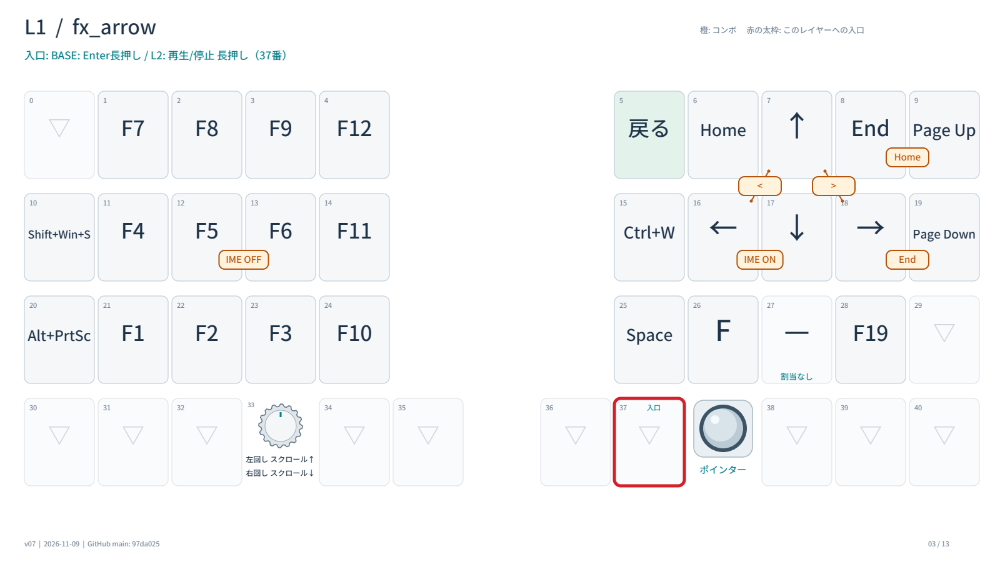](docs/keymap/l01-fx-arrow.png)

[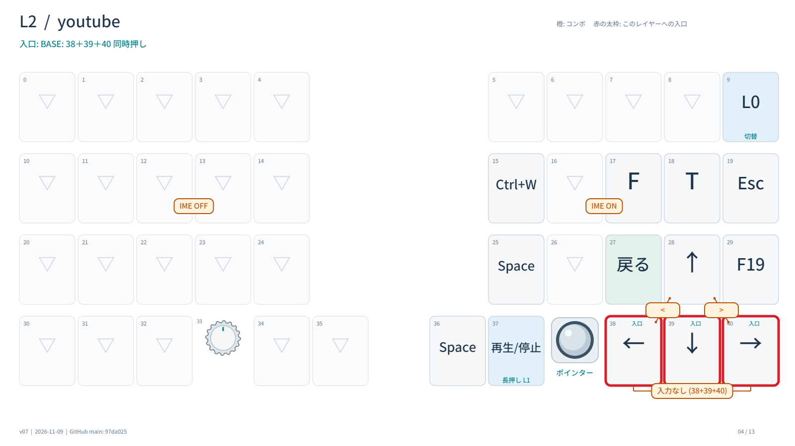](docs/keymap/l02-youtube.png)

[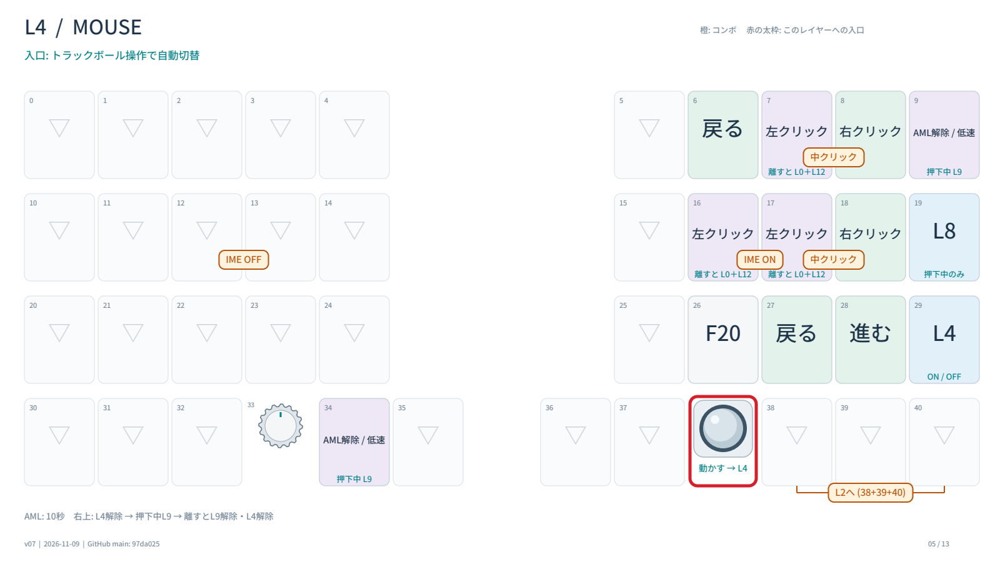](docs/keymap/l04-mouse.png)

[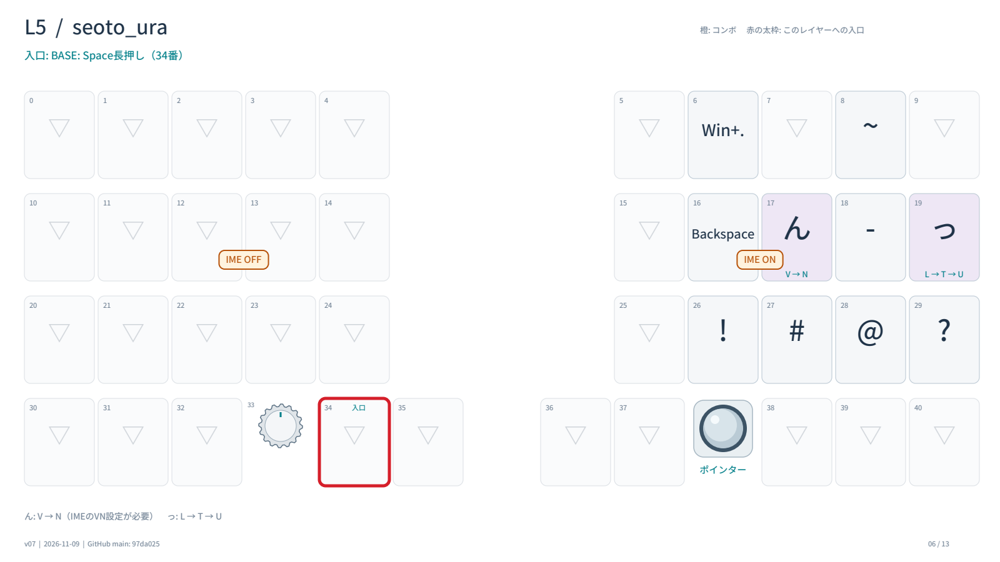](docs/keymap/l05-seoto-ura.png)

[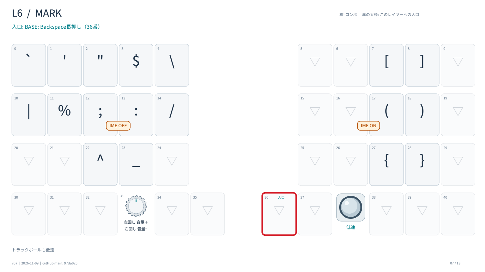](docs/keymap/l06-mark.png)

[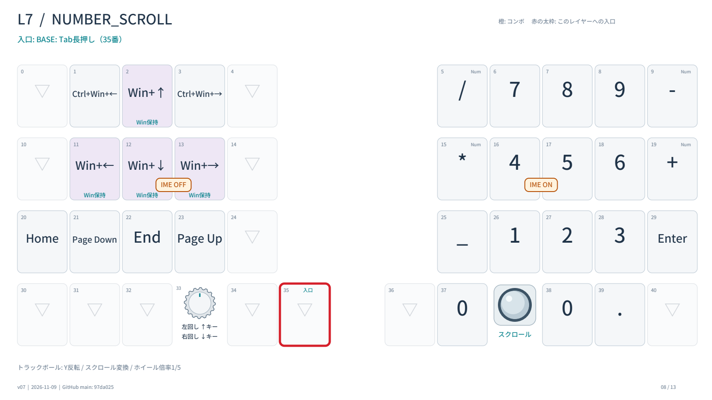](docs/keymap/l07-number-scroll.png)

[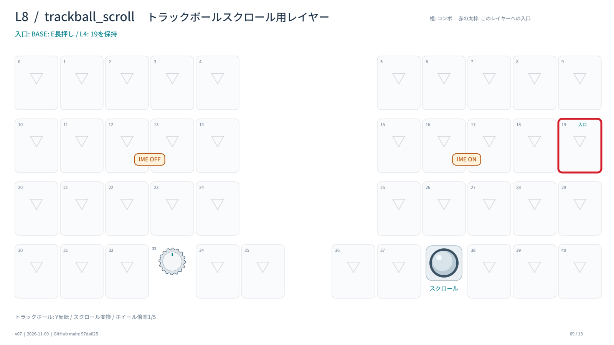](docs/keymap/l08-trackball-scroll.png)

[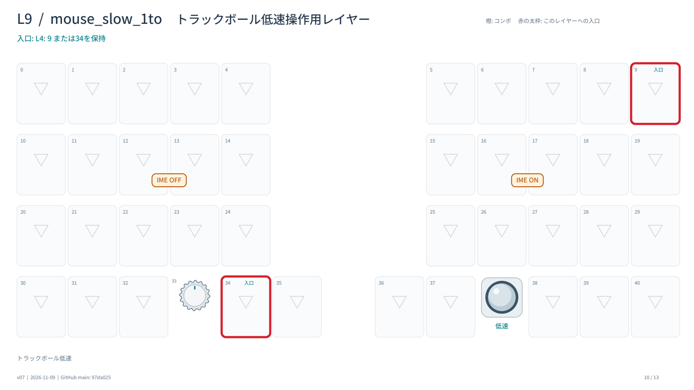](docs/keymap/l09-mouse-slow.png)

[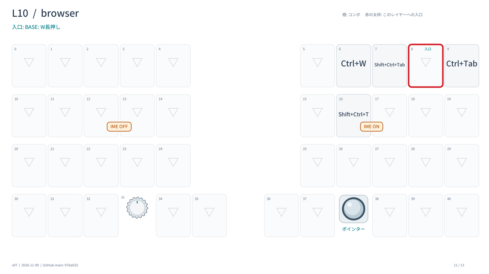](docs/keymap/l10-browser.png)

[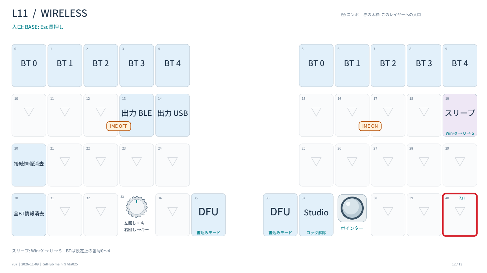](docs/keymap/l11-wireless.png)

[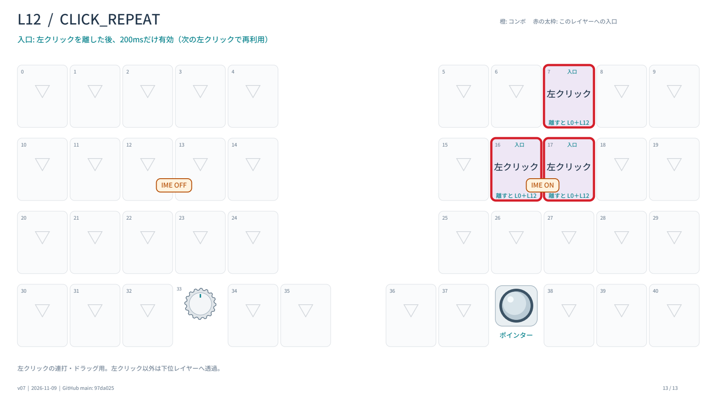](docs/keymap/l12-click-repeat.png)

[概要に戻る](#overview)

レイヤーの入口と役割

| 層 | 名前 | 入口・役割 |
| --- | --- | --- |
| 0 | `BASE` | 通常入力。せおと配列と各レイヤーへの入口 |
| 1 | `fx_arrow` | L0のEnterまたはL2の再生・停止キーを長押し。F1〜F12、矢印、Home／End、ページ移動 |
| 2 | `youtube` | 右下3キーの同時押し。動画・メディア操作 |
| 3 | `RESERVED_2` | 予約枠。キー割り当ては下位へ透過 |
| 4 | `MOUSE` | トラックボールを動かすと自動で有効。クリック、戻る／進む、スクロールへの入口 |
| 5 | `seoto_ura` | Space長押し。せおとの裏面 |
| 6 | `MARK` | Backspace長押し。記号と括弧、トラックボール低速、エンコーダーで音量 |
| 7 | `NUMBER_SCROLL` | Tab長押し。数字、Win＋矢印、トラックボールでスクロール |
| 8 | `trackball_scroll` | E長押し、またはL4の2段目右端のキーを保持。ボールでスクロール |
| 9 | `mouse_slow_1to` | L4の低速用キーを保持。一時的にポインターを低速化 |
| 10 | `browser` | W長押し。タブ切替、閉じる、閉じたタブを復元 |
| 11 | `WIRELESS` | Esc長押し。BLE・USBの切替、ペアリング、DFU、Studio解除、スリープ |
| 12 | `CLICK_REPEAT` | 左クリックを離した後、最大200 ms。左クリックの割り当てを一時的に残す |

## せおと配列と日本語入力

- **表面（L0）**はせおと配列です。WindowsではMozKeyの拡張ローマ字テーブルと組み合わせ、Q・J・X・CなどをIME側で解釈します。[せおと配列の解説](https://note.com/firstyear_dev/n/ne4aedaad09b2) · [MozKey](https://github.com/koyasi777/mozkey)
- **裏面（L5）**は、Spaceを短押しすると空白、押しながら別のキーを打つと裏面になるSandS風の構成です。「ん」は `V → N`（IMEに対応するローマ字定義が必要）、「っ」は `L → T → U` を送ります。Backspace、ハイフン、`~ ! # @ ?`、Windowsの絵文字パネルもまとめています。
- **IME切替**は、A＋IでIME ONを送ってL0に戻り、N＋TでIME OFFを送ります。Windows側でIME ON／OFFに対応するキー設定が必要です。

## オートマウスの解除

ベースにしたLiNEA40の設定では、トラックボールの操作を止めると **600 ms** でオートマウスが自動解除されます。この設定では、右手だけでマウス操作を続けやすいよう、**L4 MOUSE** の自動解除を **10秒（10,000 ms）** に延ばしています。

そのまま文字を打とうとすると、L4に残ったクリックなどの割り当てを誤って実行しやすくなります。そこで、**左クリックを離した時点でL0 BASEに戻る**ようにしています。入力欄をクリックしたあと、タイムアウトを待たずに続けて入力できます。

| 操作 | 動作 |
| --- | --- |
| 左クリックを押し続ける | 左ボタンを保持したままドラッグできる |
| 左クリックを離す | 左ボタンを解放し、L0に戻る。L12は元の3か所に左クリックを最大200 ms残し、それ以外のキーはL0へ透過する |
| 200 ms以内にもう一度左クリックする | 同じ場所でダブルクリックや連続クリックができる。もう一度離すと猶予時間が始まる |
| L4の低速用キーを押す | `mouse_exit_mo9` がL4を解除し、押下中だけL9を有効にする。離すとL9とL4を解除 |
| L4でA＋Iを押す | IMEをONにし、L0へ戻る |

クリックやF20などを使えるよう、14か所を `excluded-positions` に指定し、キーを押したときの自動解除から除外しています。左クリックによる解除はマクロで行います。L4のV位置ではマウスレイヤーを手動で切り替えられます。[除外キーの図](docs/keymap/aml-exclusions.png) · [左クリックで解除する実装の参考記事](https://qiita.com/kompeki/items/ead8f7d69e4bc00cb48c)

## トラックボールとスクロール

| 項目 | 設定 |
| --- | --- |
| センサー | PMW3610、inorichi版ドライバー、ソフトウェアポーリング125 Hz |
| ポインター感度 | 通常700 CPI。L6・L9では400 CPIの低速モード |
| 角度補正 | パッチ適用版では、キーボードを斜めに置いたときの操作方向に合わせ、トラックボールによるポインター移動を時計回りに10°補正 |
| ボールでスクロール | L7・L8でY軸を反転し、ボールの移動をホイール入力へ変換。縦ホイール倍率は1/5 |
| 左のロータリーエンコーダー | L0は縦スクロール、L1はその3倍、L6は音量、L7は上下矢印、L11は左右矢印 |
| ホイール基準値 | `ZMK_POINTING_DEFAULT_SCRL_VAL = 100` |

入力タイミングとセンサーの補足

- `&mmv` は遅延20 ms、周期5 ms、最大速度まで100 ms、加速指数2。
- `&msc` は遅延3 ms、周期3 ms、最大速度まで100 ms、加速指数0。エンコーダーのホイール出力はタップ時間20 ms。
- PMW3610はRUNから3,264 msでREST1へ移行します。REST1のサンプリング間隔は40 ms、次の休止段階への切替時間は9,600 msです。

## Bluetoothとスリープ対策

- **接続間隔の調整** — 右側の `CONFIG_BT_PERIPHERAL_PREF_MIN_INT` と `MAX_INT` をともに `6` に設定し、ホストに7.5 msを要求します。WindowsでトラックボールをBLE接続したときのレポート間隔のばらつきを減らすための調整です。実際の接続間隔はホストとの交渉で決まります。
- **キー押下まで再接続を待つパッチ** — PCの意図しないスリープ復帰を抑えるため、ペアリング済みの使用中ホストと切断したときにBLEの接続待ち（アドバタイジング）を止めます。キーを押すか、BTプロファイルを明示的に選ぶと再開します。
- **接続先と出力の切替** — L11にBT 0〜4を左右から選べる配置、BLE／USB出力切替、選択中のボンド消去と全消去、DFU、ZMK Studio解除を配置しています。
- **Windowsをスリープさせるキー** — L11の右側に `Win+X → U → S` を送るマクロを配置。

## ショートカットとWindows連携

| 機能 | 操作 |
| --- | --- |
| Layer-TapとMod-Tap | Layer-Tapは `hold-preferred`、Mod-Tapは `balanced`。L0のB・Vを短押しで文字、長押しで左右Shiftに割り当て |
| 修飾キーで割り当て変更 | PをAlt／Winと組み合わせるとTabを送り、Alt＋Tab／Win＋Tabを操作。左Ctrlと組み合わせるとK→貼り付け、M→切り取り、R→取り消し、S→全選択、N→保存、←→新規タブ、Z→タブを閉じる、F→再読み込み、G→検索 |
| ウィンドウ配置 | Tab長押しでL7を開く。方向キーを最初に押した時点でWinを保持し、同じ長押し中に方向キーを続けて入力。Tabを離すとWinを解放。Ctrl＋Win＋左右で仮想デスクトップも切替 |
| 同時押し | Escape、Insert、Delete、Ctrl＋Enter、IME切替、中クリック、最小化など。キー位置38＋39＋40は受付150 msで、L0・L4からL2へ切り替えてF19を送る |
| YouTubeとブラウザー | L2に再生・一時停止、シーク、全画面などを配置。再生・停止キーの長押しでL1のファンクション・矢印キーを使える。L10ではタブ切替・閉じる・復元を右手で操作 |
| PC側のホットキー | F18はChatGPTの音声入力用。F19は別画面のYouTubeにフォーカス、F20はマウスポインターの画面切替用。F19／F20の画面操作にはWindows側のAutoHotkey設定を使用 |

コンボのキー位置と適用レイヤー

キー位置は図の小さな数字です。「共通」はレイヤー指定のないコンボです。

| 適用レイヤー | キー位置と動作 |
| --- | --- |
| 共通 | 16＋17でIME ONとL0へ復帰、12＋13でIME OFF |
| L0 | 6＋7でInsert、8＋9または9＋16でDelete、28＋29でCtrl＋Enter、31＋32で最小化（Alt＋Space → N） |
| L0・L3 | 0＋1でEscape |
| L0・L4 | 38＋39＋40でL2へ切り替えてF19 |
| L1 | 8＋9でHome、18＋19でEnd、7＋16で `<`、7＋18で `>` |
| L2 | 28＋38で `<`、28＋40で `>`。38＋39＋40は入力を抑止 |
| L4 | 7＋8または17＋18で中クリック |

## ビルドと設定ファイル

ベースは **ZMK v0.2.1**。対象は右がトラックボール兼セントラル、左がロータリーエンコーダーのLiNEA40Aです。XIAO nRF52840向けに左右のUF2と `settings_reset` 用UF2をビルドします。

- **通常版** — `LiNEA40 original firmware MANUAL`。このリポジトリのキーマップと設定を使ってビルドします。
- **パッチ適用版** — `★LiNEA40 keypress reconnect AUTO`。同じキーマップと設定に加え、右側UF2にBLE再接続と角度補正を適用します。

[GitHub Actions](https://github.com/gilldish/zmk-config-LiNEA40/actions)

| 確認したい内容 | 参照先 |
| --- | --- |
| レイヤー、コンボ、マクロ、スクロール倍率 | [`config/LiNEA40.keymap`](config/LiNEA40.keymap) |
| AMLのタイムアウト・除外位置、低速／スクロールの対象レイヤー | [`LiNEA40_right.overlay`](config/boards/shields/LiNEA40/LiNEA40_right.overlay) |
| センサー設定・BLE接続間隔 | [`LiNEA40_right.conf`](config/boards/shields/LiNEA40/LiNEA40_right.conf) |
| ZMKと外部モジュールの版 | [`config/west.yml`](config/west.yml) |
| ビルド手順とZMKへの変更 | [`.github/workflows/`](.github/workflows/) · [`patches/`](patches/) |

[概要に戻る](#overview)
